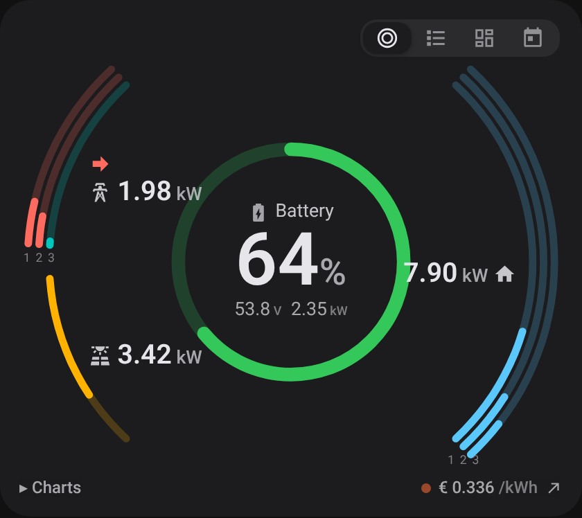
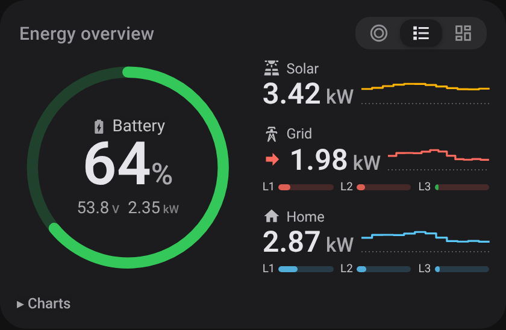
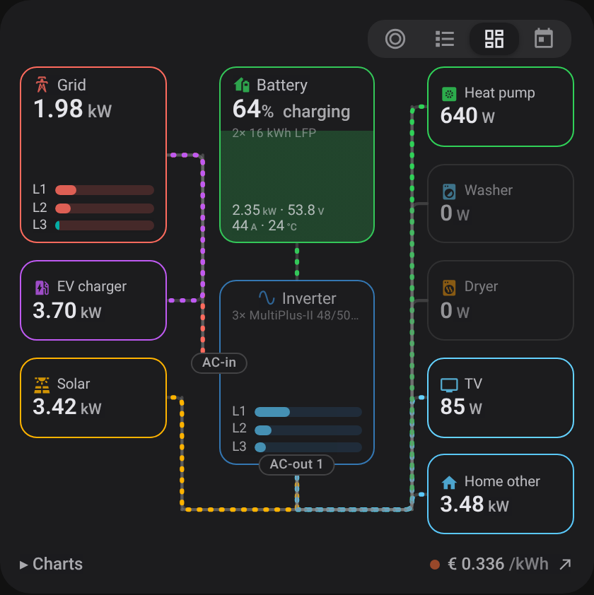
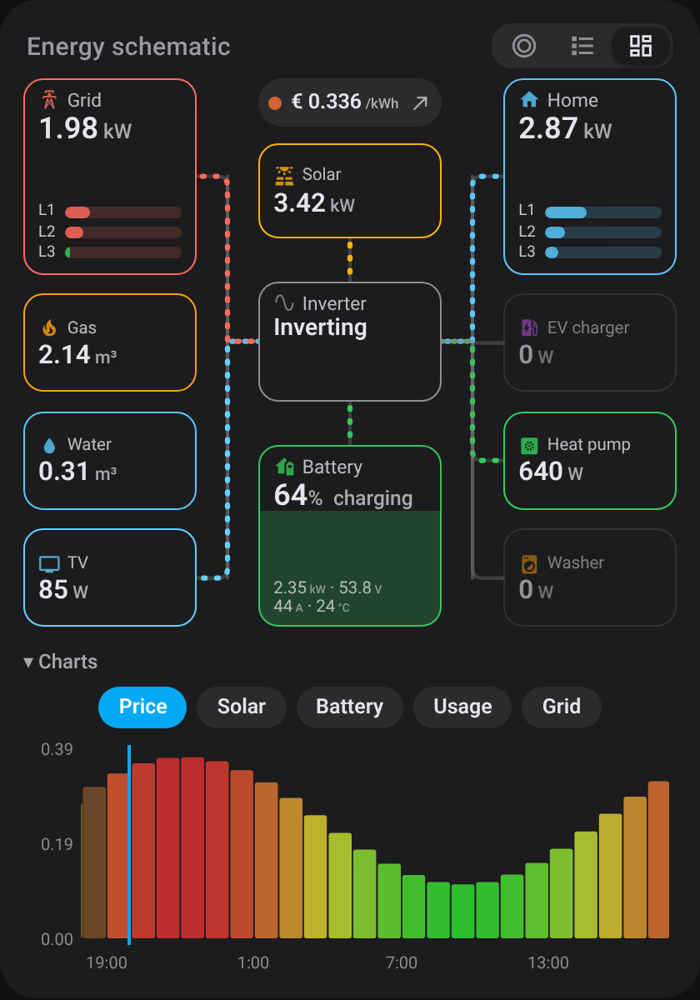

# Total Home Energy Card

[](https://hacs.xyz/docs/faq/custom_repositories)
[](https://github.com/gjvdveen/total-home-energy-flow-card/releases)
[](LICENSE)

**One card for your whole home's energy, including all the devices you measure.** Most energy cards stop at grid, solar, battery and home. This one was made because there is more: an EV charger, a heat pump, a washing machine, the TV, e-bikes on a smart plug… Add them all, next to battery, grid (per phase), solar, gas and water, the current energy price and charts. Three views, one tap apart.

🇳🇱 [Nederlandse versie](README.nl.md)

<p align="center">
  
  
  
</p>

## Why this card?

- **Many energy consumers, not just "home"**: show every device you measure (EV charger, heat pump, boiler, washing machine, TV, Shelly plugs…), each with its own tile, colour and animated line. Up to 5 per side, plus solar in the middle, and the card grows with them. An automatic **Other** tile shows everything you don't measure separately.
- **Three views in one card**: switch with the buttons in the top right; the card remembers your choice.
  - **Ring**: the battery in the middle, power arcs around it, one arc per phase.
  - **List**: the battery ring with a compact list beside it, each with a sparkline of the last hour and phase bars.
  - **Schematic**: tiles connected to the inverter with animated lines that show where the power flows.
  - **Today**: the same schematic with kWh since midnight per tile (needs `energy` sensors).
- **Per-phase power** (L1 / L2 / L3) for grid and home, including phases that export while others import.
- **Gas and water** as info tiles (today's usage).
- **Live energy price** with a colour dot (cheap → expensive compared with today) and a trend arrow for the next hour.
- **Collapsible charts**: price, solar, battery, usage and grid for the last 24 hours.
- **Works with any setup.** Built with a Victron ESS in mind, but every value is just a Home Assistant sensor.
- Light-weight: a single JavaScript file, no dependencies, follows your Home Assistant theme.

## Installation

### HACS (recommended)

1. HACS → ⋮ → **Custom repositories**
2. Repository: `https://github.com/gjvdveen/total-home-energy-flow-card`, type **Dashboard**
3. Search for **Total Home Energy Card**, install, and reload your browser.

### Manual

1. Download `total-home-energy-flow-card.js` from the [latest release](https://github.com/gjvdveen/total-home-energy-flow-card/releases).
2. Copy it to `config/www/`.
3. Settings → Dashboards → ⋮ → **Resources** → add `/local/total-home-energy-flow-card.js` as *JavaScript module*.

## Quick start

```yaml
type: custom:total-home-energy-ring-card
battery:
  soc: sensor.battery_soc
  entity: sensor.battery_power        # + = discharging, – = charging (use invert: true if yours is the other way round)
left:
  - name: Grid
    icon: mdi:transmission-tower
    entity: sensor.grid_power         # + = import, – = export
    export_color: "#34c759"
  - name: Solar
    icon: mdi:solar-power-variant
    entity: sensor.solar_power
    position: top
right:
  - name: Home
    icon: mdi:home
    entity: sensor.home_power
```

That's it. Everything else is optional.

## Full example



```yaml
type: custom:total-home-energy-ring-card
page_titles:
  ring: Energy ring
  list: Energy overview
  overview: Energy schematic
battery:
  name: Battery
  soc: sensor.battery_soc
  charge: sensor.battery_charge_power
  discharge: sensor.battery_discharge_power
  voltage: sensor.battery_voltage
  current: sensor.battery_current
  temperature: sensor.battery_temperature
  soc_alarm: 15
inverter:
  name: Inverter
  entity: sensor.inverter_state
price:
  entity: sensor.electricity_price
left:
  - name: Grid
    icon: mdi:transmission-tower
    color: "#ff6b5e"
    export_color: "#34c759"
    entity: sensor.grid_power
    phases:
      - sensor.grid_power_l1
      - sensor.grid_power_l2
      - sensor.grid_power_l3
    max: 17250                         # 3 × 25 A
  - name: Solar
    icon: mdi:solar-power-variant
    color: "#ffb300"
    entity: sensor.solar_power
    position: top
    max: 5000
  - name: Gas
    type: meter
    icon: mdi:fire
    today: sensor.gas_today
  - name: Water
    type: meter
    icon: mdi:water
    total: sensor.water_meter_total    # today's usage is taken from the statistics
right:
  - name: Home
    icon: mdi:home
    entity: sensor.home_power
    phases: [sensor.home_l1, sensor.home_l2, sensor.home_l3]
  - name: EV charger
    icon: mdi:ev-station
    color: "#bf5af2"
    entity: sensor.ev_charger_power
    max: 11000
    navigate: /dashboard-energy/ev
  - name: Heat pump
    icon: mdi:heat-pump
    entity: sensor.heat_pump_power
chart:
  tabs: [price, solar, battery, home, grid]
  hours: 24
  collapsed: true
  price:
    entity: sensor.electricity_price
    attribute: prices
    start_key: start
    value_key: price
```
<br clear="right">

## Options

### Card

| Option | Default | Description |
|---|---|---|
| `title` | – | Card title |
| `page_titles` | – | Own title per view: `ring`, `list`, `overview`, `today` |
| `title_color` | secondary text colour | Colour of the title |
| `pages` | `[ring, list, overview, today]` | Which views are available, and their order |
| `page` | first page | View shown the first time |
| `show` | left items + first right item | Names of the items on the ring and list views, e.g. `[Solar, Grid, Home]` |
| `max_power` | `10000` | Default full scale (W) of an arc or bar |
| `kw_from` | `1000` | From this many watts values are shown in kW |
| `rest` | – | `true` or `{name, icon, color, of, entity, energy}`: adds an *Other* tile = home total minus all listed consumers. `of` names the base item (default: first right item); or give `entity` (and optional `energy`) as the home total, then no home tile is needed |
| `align` | `top` | `center` places the side columns around the inverter |
| `battery_position` | `bottom` (`top` in the Victron layout) | Battery above or below the inverter in the schematic |
| `branch` | `true` | Consumers on the right hang under the first right item (home). `false` connects every item to the inverter |

### Battery (`battery`)

| Option | Description |
|---|---|
| `soc` | State of charge sensor (%) |
| `entity` | Battery power: + discharging, – charging. Or use `charge` + `discharge` (two positive sensors) |
| `invert` | Flip the sign of `entity` |
| `voltage`, `current`, `temperature` | Optional extra values |
| `soc_alarm` | Below this % the battery turns red (default `15`) |
| `energy_charge`, `energy_discharge` | Battery kWh meters for the *Today* view |
| `name`, `icon`, `color`, `navigate` | Look and tap action |
| `charging_name`, `discharging_name`, `idle_name` | Your own words for the states |

### Items (`left` / `right`)

`left` holds sources (grid, solar…), `right` holds consumers. Up to 5 tiles per side in the schematic.

| Option | Description |
|---|---|
| `name`, `icon`, `color` | Label and colour |
| `entity` | Power sensor (W or kW) |
| `phases` | List of per-phase power sensors (L1, L2, L3) |
| `invert` | Flip the sign |
| `export_color` | Colour used when the value is negative (export); also enables the direction arrow |
| `import_name`, `export_name` | Words for import / export |
| `max` | Full scale in W for this item (split over the phases) |
| `position: top` | Place the item above the inverter in the schematic (e.g. solar) |
| `load: true` | A consumer placed on the left side (flow direction is reversed) |
| `ac` | `in`, `out1` or `out2`: where the item is connected to a Victron inverter/charger. As soon as one item uses `out1`/`out2` the schematic switches to the Victron layout (AC-in left, AC-out 1 and AC-out 2 right). `in` items are left out of *Other* unless `in_rest: true` |
| `source: true` | The item produces power on an AC-out branch (e.g. a PV inverter on AC-out 1) |
| `size` | `small` or `large` tile in the schematic |
| `in_rest: false` | Don't subtract this item when calculating *Other* (e.g. an EV charger that isn't part of the home total) |
| `navigate` | Path to open on tap (otherwise the more-info dialog opens) |
| `energy` | kWh meter (total) for the *Today* view |
| `energy_import`, `energy_export` | Grid kWh meters for the *Today* view |
| `type: meter` | Info tile without a line, e.g. gas or water. Use `entity` (current value), `today` (a daily sensor) or `total` (a meter; today's usage is calculated from the statistics) |

### Inverter (`inverter`)

`name`, `entity` (a state sensor, e.g. *Inverting* / *Charging*), `icon`, `color`, `navigate`, `phases` (list of per-phase power sensors, shown as bars), `max`.

### Price (`price`)

| Option | Description |
|---|---|
| `entity` | Sensor with the current price |
| `attribute`, `start_key`, `value_key` | Where the list of upcoming prices lives (for the colour dot and the trend arrow). If omitted, the settings of `chart.price` are used |
| `decimals` | Default `3` |
| `prefix` | Default `€ ` |

### Charts (`chart`)

| Option | Description |
|---|---|
| `tabs` | Any of `price`, `solar`, `battery`, `home`, `grid` |
| `hours` | Time span, default `24` |
| `collapsed` | Start collapsed (the card remembers what you choose) |
| `price` | `entity`, `attribute`, `start_key`, `value_key` of the price list |

## Energy prices

The price label only needs a sensor whose state is the current price, so it works with every price integration. The colour dot, the trend arrow and the price chart also need the list of hourly prices in an attribute. Common integrations:

| Integration | `attribute` | `start_key` | `value_key` |
|---|---|---|---|
| [Nord Pool (custom)](https://github.com/custom-components/nordpool) | `raw_today` | `start` | `value` |
| [ENTSO-e](https://github.com/JaccoR/hass-entso-e) | `prices` | `time` | `price` |
| ANWB Energie, Frank Energie and others | check the attributes of your sensor in *Developer tools → States* | | |

Lists of `[time, price]` pairs are recognised automatically. Integrations that only offer the prices through an action (such as the built-in Nord Pool and EnergyZero integrations) need a template sensor first; without a list the card simply hides the price tab.

## Victron users

Use `ac: in / out1 / out2` on your items to draw the schematic exactly like your installation is wired, e.g. the EV charger on AC-in and a PV inverter (`source: true`) plus your backup loads on AC-out 1.


With the [Victron GX integration](https://github.com/sfstar/hass-victron) or Modbus you typically use:

- `battery.soc`, `voltage`, `current`: the battery monitor / BMS
- grid phases: the grid meter (e.g. VM-3P75CT / ET340) per phase
- home phases: the MultiPlus / Quattro *output power L1-L3* (AC loads)
- `inverter.entity`: the system state (*External control*, *Inverting*, …)

## Also included: Total Home Energy Flow Card

The same file also contains `custom:total-home-energy-flow-card`, a flow-style card with a round home "mix" ring and a Now / Today toggle. It is kept for compatibility; the ring card above is the recommended one.

## License

[MIT](LICENSE). Feedback and pull requests are welcome!
