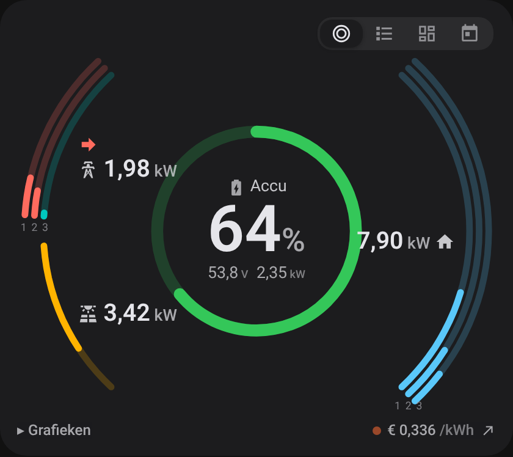
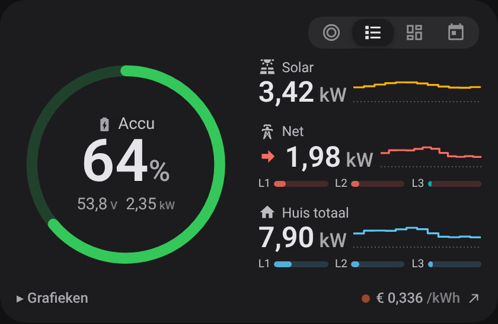
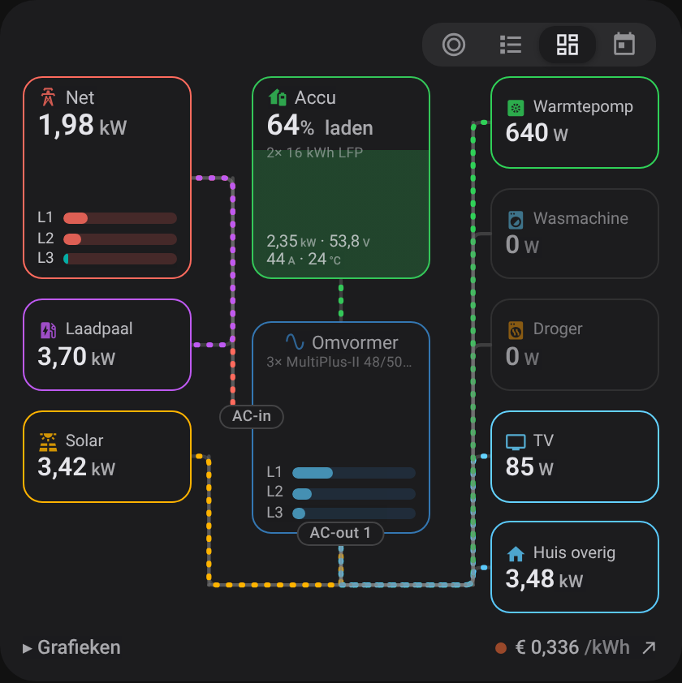
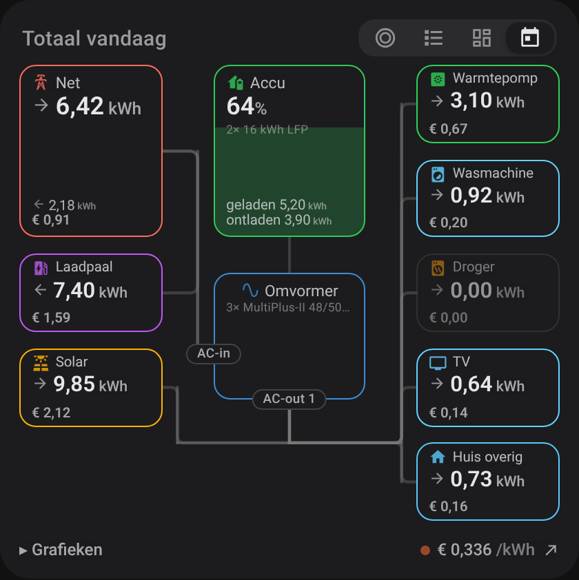

# Total Home Energy Card

[](https://hacs.xyz/docs/faq/custom_repositories)
[](https://github.com/gjvdveen/total-home-energy-flow-card/releases)
[](LICENSE)

**Eén kaart voor alle energie in huis, inclusief alle apparaten die je meet.** De meeste energiekaarten houden op bij net, zon, accu en huis. Deze kaart is gemaakt omdat er meer is: een laadpaal, een warmtepomp, een wasmachine, de tv, de e-bikes aan een slimme stekker… Zet ze er allemaal bij, naast accu, net (per fase), zonnepanelen, gas en water, de actuele stroomprijs en grafieken. Drie weergaven, één tik van elkaar.

🇬🇧 [English version](README.md)

<p align="center">
  
  
  
  
</p>

## Waarom deze kaart?

- **Meerdere energieverbruikers, niet alleen "huis"**: elk apparaat dat je meet (laadpaal, warmtepomp, boiler, wasmachine, tv, Shelly-stekkers…) krijgt een eigen tegel, kleur en bewegende lijn. Tot 5 per kant, plus solar in het midden, en de kaart groeit mee. Een automatische tegel **Overig** toont alles wat je niet apart meet (`rest: true`).
- **Vier weergaven in één kaart**: wissel met de knopjes rechtsboven; de kaart onthoudt je keuze.
  - **Ring**: de accu in het midden met vermogensbogen eromheen, per fase een eigen boog.
  - **Lijst**: de accuring met ernaast een compacte lijst, met een mini-grafiek van het laatste uur en fasebalkjes.
  - **Schema**: tegels die met de omvormer verbonden zijn via bewegende lijnen die laten zien waar de stroom heen gaat.
  - **Vandaag**: hetzelfde schema met de kWh sinds middernacht per tegel en wat het kostte, met de uurprijs (vraagt `energy`-sensoren).
- **Vermogen per fase** (L1 / L2 / L3) voor net en huis, ook als één fase teruglevert terwijl de andere afnemen.
- **Gas en water** als informatietegels (verbruik van vandaag).
- **Actuele stroomprijs** met een gekleurd bolletje (goedkoop → duur ten opzichte van vandaag) en een pijltje. Tik erop voor het goedkoopste uur, het goedkoopste blok van 3 uur en het duurste uur van vandaag en morgen.
- **Schema in Victron-stijl**: geef per apparaat aan of het op AC-in, AC-out 1 of AC-out 2 zit en de kaart tekent het zo, met het type omvormer en het vermogen per fase.
- **Uitklapbare grafieken**: prijs, solar, accu, verbruik en net over de afgelopen 24 uur.
- **Werkt met elke installatie.** Gemaakt met een Victron ESS in gedachten, maar elke waarde is gewoon een Home Assistant-sensor.
- Licht: één JavaScript-bestand, geen afhankelijkheden, volgt je Home Assistant-thema.

## Installatie

### HACS (aanbevolen)

1. HACS → ⋮ → **Custom repositories**
2. Repository: `https://github.com/gjvdveen/total-home-energy-flow-card`, type **Dashboard**
3. Zoek **Total Home Energy Card**, installeer, en ververs je browser.

### Handmatig

1. Download `total-home-energy-flow-card.js` uit de [nieuwste release](https://github.com/gjvdveen/total-home-energy-flow-card/releases).
2. Kopieer het naar `config/www/`.
3. Instellingen → Dashboards → ⋮ → **Bronnen** → voeg `/local/total-home-energy-flow-card.js` toe als *JavaScript-module*.

## Snel starten

```yaml
type: custom:total-home-energy-ring-card
battery:
  soc: sensor.accu_soc
  entity: sensor.accu_vermogen        # + = ontladen, – = laden (invert: true als het bij jou andersom is)
left:
  - name: Net
    icon: mdi:transmission-tower
    entity: sensor.net_vermogen       # + = afname, – = teruglevering
    export_color: "#00c7be"
  - name: Solar
    icon: mdi:solar-power-variant
    entity: sensor.solar_vermogen
    position: top
right:
  - name: Huis
    icon: mdi:home
    entity: sensor.huis_vermogen
  - name: Laadpaal
    icon: mdi:ev-station
    entity: sensor.laadpaal_vermogen
  - name: Warmtepomp
    icon: mdi:heat-pump
    entity: sensor.warmtepomp_vermogen
```

Een volledig voorbeeld en alle opties staan in de [Engelse README](README.md#full-example). De optienamen zijn hetzelfde. Handig in het Nederlands:

```yaml
page_titles:
  ring: Energie ring
  list: Energie overzicht
  overview: Energie schema
battery:
  name: Accu
  charging_name: laden
  discharging_name: ontladen
  idle_name: rust
left:
  - name: Net
    import_name: afname
    export_name: teruglevering
```

## Stroomprijzen

Het prijslabel heeft alleen een sensor nodig met de huidige prijs, dus het werkt met elke prijsintegratie. Voor het bolletje, het pijltje en de prijsgrafiek is ook de lijst met uurprijzen in een attribuut nodig:

| Integratie | `attribute` | `start_key` | `value_key` |
|---|---|---|---|
| [Nord Pool (custom)](https://github.com/custom-components/nordpool) | `raw_today` | `start` | `value` |
| [ENTSO-e](https://github.com/JaccoR/hass-entso-e) | `prices` | `time` | `price` |
| ANWB Energie, Frank Energie en andere | bekijk de attributen van je sensor via *Ontwikkelaarshulpmiddelen → Toestanden* | | |

Integraties die hun prijzen alleen via een actie geven (zoals de ingebouwde Nord Pool- en EnergyZero-integratie) hebben eerst een template-sensor nodig. Zonder lijst laat de kaart het tabblad Prijs gewoon weg.

## Licentie

[MIT](LICENSE). Feedback en pull requests zijn welkom!
